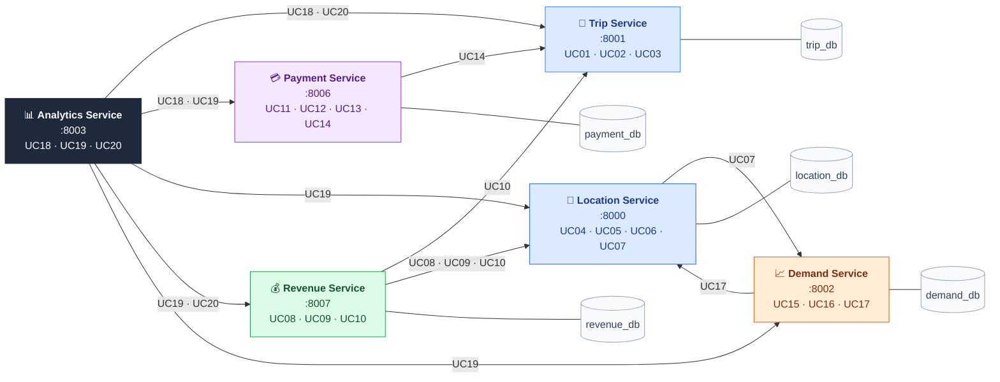

<div align="center">

# 🚕 UrbanPulse

### Plataforma de análise de mobilidade urbana baseada em microserviços

_Projeto de **Computação em Nuvem** — Grupo 4_

📅 **Junho de 2026**


</div>

---

## 📖 Sobre o projeto

A **UrbanPulse** é uma plataforma de análise histórica de dados de mobilidade urbana, oferecida como serviço. Os clientes usam os padrões históricos como _baseline_ para os seus próprios sistemas de decisão: estimativa de preços, gestão de frota e planeamento urbano.

Os dados vêm do dataset público de viagens de táxis amarelos de Nova Iorque (_NYC Yellow Taxi Trip Data_), com pickups, dropoffs, tarifas, gorjetas e métodos de pagamento.

🔗 **Dataset:** <https://www.kaggle.com/datasets/elemento/nyc-yellow-taxi-trip-data>

### Capacidades de negócio

| Capacidade                            | Descrição                                                                 |
| ------------------------------------- | ------------------------------------------------------------------------- |
| 🧭 **Trip Intelligence**              | Padrões históricos de viagens: distâncias, durações e rotas               |
| 💰 **Revenue & Pricing Intelligence** | Tarifas e receitas por zona, período e tipo de serviço                    |
| 💳 **Payment & Tipping Analytics**    | Comportamento de pagamento e gorjetas por zona e método                   |
| 📈 **Demand Intelligence**            | Padrões temporais e geográficos da procura por zona e período             |

---

## 👥 Autores

| Nome                  | Nº aluno | Responsabilidade principal        |
| --------------------- | -------- | --------------------------------- |
| **Diogo Sousa**       | 60250    | Location Service                  |
| **Francisco Lopes**   | 60252    | Revenue Service                   |
| **Guilherme Almeida** | 60264    | Trip Service                      |
| **Pedro Rosa**        | 60294    | Payment Service                   |

---

## 🏗️ Arquitetura

O sistema tem **6 microserviços** em **FastAPI**. Cada serviço com dados tem a sua própria base de dados **PostgreSQL** (padrão _database-per-service_). Os serviços comunicam entre si por **gRPC**, e o **Analytics Service** agrega informação de todos os outros. As setas indicam quem chama quem e para que caso de uso.



### Ligações gRPC

| Quem chama  | Serviço chamado                          | Casos de uso                                                                  |
| ----------- | ---------------------------------------- | ----------------------------------------------------------------------------- |
| Analytics   | Trip · Payment                           | UC18: relação duração vs gorjeta                                              |
| Analytics   | Location · Revenue · Payment · Demand    | UC19: zonas ricas vs periféricas                                              |
| Analytics   | Trip · Revenue                           | UC20: viagens anómalas                                                        |
| Revenue     | Location                                 | UC08 · UC09 · UC10: nomes e dados das zonas                                   |
| Revenue     | Trip                                     | UC10: preço por km                                                            |
| Payment     | Trip                                     | UC14: passageiros vs gorjeta                                                  |
| Location    | Demand                                   | UC07: perfil de zona (padrões de procura)                                     |
| Demand      | Location                                 | UC17: volatilidade por zona                                                   |

Na cloud (GKE) juntam-se ao sistema:

- **Ingress** como ponto de entrada único
- **HPA** para escalar os serviços automaticamente
- **Redis** para cache
- **Prometheus + Grafana** para monitorização
- Uma **Cloud Function** (FaaS) que carrega os dados de viagens a partir do Cloud Storage

### Portas

| Serviço           | REST | gRPC  | BD   |
| ----------------- | ---- | ----- | ---- |
| Location Service  | 8000 | 50054 | 5437 |
| Trip Service      | 8001 | 50051 | 5436 |
| Demand Service    | 8002 | 50053 | 5434 |
| Analytics Service | 8003 | —     | —    |
| Payment Service   | 8006 | 50052 | 5435 |
| Revenue Service   | 8007 | 50055 | 5433 |
| Prometheus        | 9090 | —     | —    |
| Grafana           | 3000 | —     | —    |
| Redis             | 6379 | —     | —    |

---

## 📂 Estrutura do repositório

O projeto foi desenvolvido por fases. Cada pasta corresponde a uma entrega:

| Pasta                                                                        | Conteúdo                                                          |
| ---------------------------------------------------------------------------- | ----------------------------------------------------------------- |
| [`phase1/`](phase1/)                                                         | Dataset, capacidades de negócio e casos de uso                    |
| [`phase2 - API/`](<phase2 - API/>)                                           | Especificações OpenAPI de cada serviço                            |
| [`phase3 - Functional Requirements/`](<phase3 - Functional Requirements/>)   | Requisitos funcionais e diagrama da arquitetura                   |
| [`phase 4 - Implementation/`](<phase 4 - Implementation/>)                   | Implementação dos microserviços com Docker Compose                |
| [`phase 5 - Kubernetes/`](<phase 5 - Kubernetes/>)                           | Manifests Kubernetes (local e GKE) com HPA e Ingress              |
| [`Phase 6/`](<Phase 6/>)                                                     | Requisitos não funcionais: monitorização                          |
| [`phase 7 - Deployment 2/`](<phase 7 - Deployment 2/>)                       | Deploy no GKE com Secrets, Redis, Prometheus, Grafana e FaaS      |
| [`phase 8 - Automation/`](<phase 8 - Automation/>)                           | Testes (unitários, PR e integração) e pipeline CI/CD              |
| [`taxiZonesScript/`](taxiZonesScript/)                                       | Script que limpa o dataset e associa as viagens às zonas de NYC   |
| [`.github/workflows/`](.github/workflows/)                                   | Workflows de GitHub Actions (um por aluno)                        |

---

## 🚀 Como executar

### Pré-requisitos

- [Python 3.11+](https://www.python.org/)
- [Docker](https://www.docker.com/) e Docker Compose
- Para Kubernetes: `kubectl` e Docker Desktop com Kubernetes ou minikube
- Para a cloud: uma conta Google Cloud com a [gcloud CLI](https://cloud.google.com/sdk/docs/install)

### 1️⃣ Preparar os dados

1. Descarregar o ficheiro `yellow_tripdata_2015-01.csv` do [Kaggle](https://www.kaggle.com/datasets/elemento/nyc-yellow-taxi-trip-data) e colocá-lo em `taxiZonesScript/`.
2. Instalar as dependências e gerar o CSV limpo, já com as zonas de pickup e dropoff:

   ```bash
   pip install pandas geopandas
   python taxiZonesScript/taxiZones.py
   ```

   O script cria `taxiZonesScript/yellow_tripdata_2015-01_clean.csv`.

3. Copiar `yellow_tripdata_2015-01_clean.csv` para uma pasta `data/` em cada microserviço da `phase 4 - Implementation`:
   - `location-service`
   - `demand-service`
   - `payment-service`
   - `trip-service`
   - `revenue-service`

   As pastas `data/` têm de ser criadas à mão. O Analytics Service não precisa de nenhuma. O **Location Service** também precisa do ficheiro `taxi_zone_lookup.csv`, que está em `taxiZonesScript/`.

> [!NOTE]
> Por omissão, os `seed.py` estão limitados a **10 mil linhas** para testes rápidos. Para mudar este limite, altera o valor de `SAMPLE_ROWS` (ou `nrows`) em cada `seed.py`.

> [!TIP]
> Para um teste rápido sem descarregar o dataset do Kaggle, usa como `yellow_tripdata_2015-01_clean.csv` o ficheiro `phase 8 - Automation/test-data/test_trips.csv`. São 5000 viagens já limpas.

### 2️⃣ Configurar as passwords (`.env`)

As passwords das bases de dados **não estão no código**. Ficam num ficheiro `.env`, que está no `.gitignore`. O repositório inclui um modelo, o `.env.example`:

```bash
cd "phase 4 - Implementation"
cp .env.example .env
# editar o .env e definir as passwords
```

O `docker-compose.yml` lê o `.env` automaticamente, e os `seed.py` também.

> [!IMPORTANT]
> O Postgres só lê a password na **primeira** vez que cria a base de dados. Se já correste o projeto antes com outra password, apaga as pastas `*/db-data/` (ou corre `docker compose down -v`) antes de voltar a arrancar. Se não o fizeres, os seeds falham com `password authentication failed`.

### 3️⃣ Executar localmente com Docker Compose

Na pasta `phase 4 - Implementation`:

```bash
docker compose up --build
```

Com os containers a correr, instala as dependências dos seeds e popula as bases de dados:

```bash
pip install pandas sqlalchemy psycopg2-binary python-dotenv numpy

python location-service/seed.py
python demand-service/seed.py
python demand-service/seed_extra.py   # gera mais meses de dados para as tendências mensais
python payment-service/seed.py
python trip-service/seed.py
python revenue-service/seed.py
```

> [!TIP]
> Se um serviço falhar com um erro de ligação à base de dados, a porta provavelmente já está ocupada no teu PC. Muda a porta desse serviço em três sítios e usa sempre o mesmo valor: o `docker-compose.yml` global, o `docker-compose.yml` do serviço e o `seed.py`.

### 4️⃣ Executar em Kubernetes local

Os passos estão em [`phase 5 - Kubernetes/READMELocal.md`](<phase 5 - Kubernetes/READMELocal.md>) e [`phase 5 - Kubernetes/README_local_kubernetes.md`](<phase 5 - Kubernetes/README_local_kubernetes.md>). Em resumo:

```bash
kubectl create namespace urbanpulse
kubectl create configmap location-db-init --from-file=init.sql=./location-service/db/init.sql -n urbanpulse
docker build -t location-api:latest ./location-service
kubectl apply -f "../phase 5 - Kubernetes/kubernetesLocal/location-service/"
kubectl get pods -n urbanpulse
```

### 5️⃣ Deploy na Google Cloud (GKE)

O guia completo está em [`phase 8 - Automation/READMECloud.md`](<phase 8 - Automation/READMECloud.md>). As etapas principais são:

1. **Publicar as imagens** no Artifact Registry. Ver [`READMEArtifactRegistry.md`](<phase 8 - Automation/READMEArtifactRegistry.md>).
2. **Criar o cluster:**

   ```bash
   gcloud container clusters create urbanpulse \
     --zone=europe-west1-b --num-nodes=5 --machine-type=e2-medium
   kubectl create namespace urbanpulse
   ```

3. **Criar os ConfigMaps** com o `init.sql` de cada BD.
4. **Criar os Secrets a partir do `.env`.** Copia o `phase 8 - Automation/.env.example` para `~/.env` no Cloud Shell, define as passwords e corre:

   ```bash
   bash ~/kubernetesCloud/create-secrets.sh
   ```

   O script cria os Secrets das 5 BDs e o do Grafana. Nenhuma password fica nos YAMLs.
5. **Aplicar os manifests** de `kubernetesCloud/`: serviços, Redis, Prometheus, Grafana e, por fim, o Ingress.
6. **Popular as BDs** com `kubectl port-forward` e `seed.py`. A Trip DB é a exceção: quem a popula é a **Cloud Function**. Ver [`CloudFunction/README.md`](<phase 8 - Automation/CloudFunction/README.md>).
7. **Aceder** através do IP do Ingress:
   - `/prometheus`
   - `/grafana`
   - endpoints REST de cada serviço

> [!WARNING]
> **Para não gastar créditos**, apaga os recursos quando acabares:
>
> ```bash
> gcloud functions delete trip-data-ingestion --region=europe-west1 --gen2
> gcloud container clusters delete urbanpulse --zone=europe-west1-b
> gcloud compute disks list   # confirmar que não ficaram discos órfãos
> ```

### 6️⃣ Testes e CI/CD

Cada serviço em `phase 8 - Automation/MicroServices/` tem dois ficheiros de testes:

- `tests.py`: testes unitários
- `tests_pr.py`: testes de Pull Request

Os testes de integração ficam em `phase 8 - Automation/tests_integration/`.

```bash
# Testes unitários de um serviço
cd "phase 8 - Automation/MicroServices/payment-service"
pip install -r requirements.txt pytest httpx
pytest tests.py

# Testes de integração, com os serviços reais e sem mocks
cd "phase 8 - Automation"
cp .env.example .env
docker compose -f docker-compose-test.yml up -d --build
# os seed.py leem o CSV de ~/yellow_tripdata_2015-01_clean.csv (podes usar o test-data/test_trips.csv)
(cd MicroServices/location-service && python seed.py)   # repetir para demand, revenue, trip e payment
pytest tests_integration/
```

No GitHub Actions, o `.env` é criado a partir do `.env.example`. As BDs de teste são temporárias e são destruídas no fim de cada execução.

O pipeline de GitHub Actions corre automaticamente:

| Trigger                | Stages                                                    |
| ---------------------- | --------------------------------------------------------- |
| Push para branch `NNNNN` | Lint + Unit Tests                                       |
| Pull Request para `main` | Lint + Unit Tests + PR Tests                            |
| Push para `main`         | Lint + Unit Tests + Integration Tests + Build & Push (CD) |

Mais detalhes em [`phase 8 - Automation/README_CICD.md`](<phase 8 - Automation/README_CICD.md>).

---

## 🔌 Endpoints para testar

A documentação interativa (Swagger) de cada serviço está em `http://localhost:<porta>/docs`.

<details>
<summary><b>📍 Location Service</b> (:8000)</summary>

```
http://localhost:8000/health
http://localhost:8000/locations/pickup/ranking
http://localhost:8000/locations/161/dropoffs
http://localhost:8000/locations/pairs?min_trips=1
http://localhost:8000/locations/161/profile
http://localhost:8000/locations/zones
```

</details>

<details>
<summary><b>🚖 Trip Service</b> (:8001)</summary>

```
http://localhost:8001/health
http://localhost:8001/trips/classification/time-of-day
http://localhost:8001/trips/route-deviation?summary_only=true
http://localhost:8001/trips/speed/zones
```

</details>

<details>
<summary><b>📈 Demand Service</b> (:8002)</summary>

```
http://localhost:8002/health
http://localhost:8002/demand/hourly-matrix?year=2015
http://localhost:8002/demand/monthly-trend?year_from=2015
http://localhost:8002/demand/zone-volatility?zone_id=161
```

</details>

<details>
<summary><b>📊 Analytics Service</b> (:8003)</summary>

```
http://localhost:8003/health
http://localhost:8003/analytics/mobility-comparison
```

</details>

<details>
<summary><b>💳 Payment Service</b> (:8006)</summary>

```
http://localhost:8006/api/v1/payments/distribution
http://localhost:8006/api/v1/payments/tips/comparison
http://localhost:8006/api/v1/payments/zones/tipping-score
```

</details>

<details>
<summary><b>💰 Revenue Service</b> (:8007)</summary>

```
http://localhost:8007/health
http://localhost:8007/revenue/avg-fare-by-zone
http://localhost:8007/revenue/breakdown
http://localhost:8007/revenue/breakdown?zone_id=161&year=2015
http://localhost:8007/revenue/fare-per-km
http://localhost:8007/revenue/fare-per-km?sort=asc&limit=5
```

</details>

---

<div align="center">

**UrbanPulse** · Computação em Nuvem · Grupo 4 · Junho de 2026

</div>
