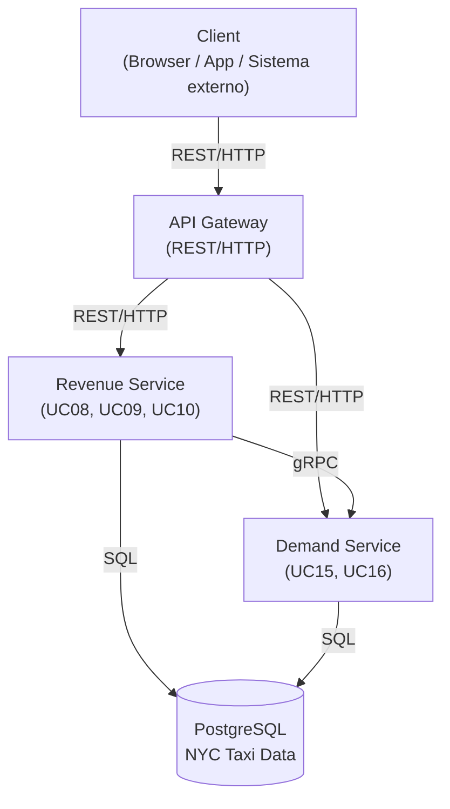

# Functional Requirements — Phase 3

Francisco Lopes | 60252

## UC08 — Tarifa Média por Zona com Desvio face à Média Global

- FR-08.1 — O sistema devolve a tarifa média por zona de pickup ou dropoff, acompanhada do desvio absoluto e percentual face à tarifa média global, calculada sobre todas as zonas.
- FR-08.2 — O sistema suporta filtragem por ano e mês, ordenação por tarifa média (ascendente ou descendente) e limitação do número de zonas devolvidas.
- FR-08.3 — O sistema devolve a tarifa média global, o número de viagens considerado por zona e os filtros aplicados, para permitir verificação dos valores calculados.

## UC09 — Decomposição Percentual da Receita por Viagem

- FR-09.1 — O sistema devolve, para cada componente do valor total da viagem (tarifa base, gorjeta, portagens, taxa MTA, sobretaxa de melhoria e extras), o valor médio em USD e a respetiva percentagem face ao total médio.
- FR-09.2 — O sistema suporta filtragem por zona, tipo de zona (pickup ou dropoff), ano e mês. Na ausência de filtros, o cálculo abrange todas as viagens disponíveis.
- FR-09.3 — O sistema devolve o número de viagens utilizadas no cálculo e os filtros aplicados, para permitir verificação dos valores calculados.

## UC10 — Preço por km por Zona

- FR-10.1 — O sistema devolve o preço médio por quilómetro para cada zona, derivado da relação entre a tarifa e a distância percorrida, com suporte a agrupamento por zona de pickup ou dropoff.
- FR-10.2 — O sistema suporta filtragem por ano e mês, ordenação por preço por km e limitação do número de resultados devolvidos.
- FR-10.3 — O sistema devolve, por zona, a distância média das viagens, a tarifa média, o número de viagens considerado e os filtros aplicados, para permitir verificação dos valores calculados.

## UC15 — Matriz Hora vs Dia com Identificação de Horas de Ponta

- FR-15.1 — O sistema devolve uma matriz de contagem de viagens organizada por hora do dia (0–23) e dia da semana (0=segunda, 6=domingo), onde cada célula indica o número de viagens e se corresponde a uma hora de ponta.
- FR-15.2 — A classificação de hora de ponta é determinada com base no desvio face à média global de viagens por célula, incluída na resposta como referência.
- FR-15.3 — O sistema suporta filtragem por zona de pickup, ano e mês, e devolve os filtros aplicados na resposta.

## UC16 — Evolução Mensal com Variação Percentual e Tendência

- FR-16.1 — O sistema devolve a contagem mensal de viagens para o período solicitado, com a variação percentual face ao período de referência anterior para cada mês, exceto o primeiro.
- FR-16.2 — O sistema suporta dois modos de comparação: mês a mês (`month`) e mesmo mês do ano anterior (`year`), com `month` como valor por omissão.
- FR-16.3 — O sistema calcula e devolve a tendência global do período (`upward`, `downward` ou `stable`), suporta filtragem por zona e intervalo de anos, e inclui os filtros aplicados na resposta.

## Descrição da Arquitetura

A arquitetura segue um modelo de microserviços, com dois serviços independentes: **Revenue Service**, responsável pelos casos de uso UC08, UC09 e UC10, e **Demand Service**, responsável pelos UC15 e UC16.

Um cliente externo comunica com a aplicação via REST/HTTP, através de uma API Gateway que encaminha os pedidos para o microserviço responsável. Cada serviço comunica com a base de dados PostgreSQL onde os dados históricos de viagens estão carregados. Nos casos em que um microserviço necessite de dados de outro, a comunicação é feita diretamente entre serviços via gRPC, sem necessidade de passar novamente pela gateway.

Esta separação permite que cada serviço seja desenvolvido, escalado e modificado de forma independente.

