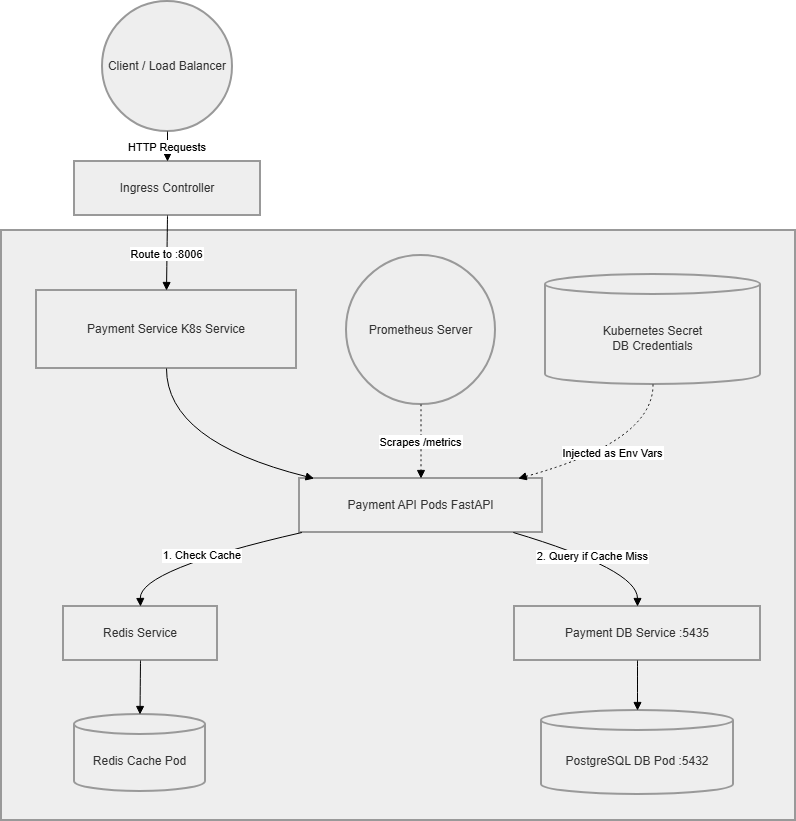

# Fase 6 - Requisitos Não-Funcionais e Arquitetura Técnica

Serviço: Payment Service

Proposta de Melhoria: Arquitetura "Production-Ready" (Segurança, Performance e Observabilidade)

## 1 - Casos de Uso (Melhorados)

Nesta fase, o foco não é adicionar novas funcionalidades de negócio, mas sim garantir que os casos de uso existentes do Payment Service (como a análise de gorjetas e distribuição de pagamentos) operam com os padrões exigidos numa infraestrutura Cloud nativa:

UC_NF1 (Otimização de Leituras): O sistema deve responder a pedidos de dados históricos (ex: dados de viagens de 2015) de forma instantânea, evitando recalcular agregações pesadas na base de dados em cada pedido.

UC_NF2 (Acesso Seguro a Dados): A API de pagamentos deve conseguir autenticar-se na base de dados PostgreSQL sem que as credenciais estejam expostas no código fonte ou nos manifestos YAML.

UC_NF3 (Monitorização de Saúde e Tráfego): A equipa de operações deve conseguir aceder a métricas em tempo real sobre a quantidade de pedidos processados pelo Payment Service e a sua taxa de sucesso/erro.

## 2 - Requisitos

### 2.1 - Requisitos Funcionais

O Payment Service deve continuar a expor os seus endpoints REST e gRPC originais.

Os cálculos matemáticos sobre gorjetas e métodos de pagamento devem manter-se precisos e consistentes com o dataset.

### 2.2 - Requisitos Não-Funcionais (Foco da Fase 6)

Performance (Cache-aside): Respostas a pedidos GET repetidos devem ter uma latência inferior a 50ms, utilizando uma camada de cache em memória para aliviar a carga no PostgreSQL.

Segurança (Secret Management): Utilização rigorosa de Kubernetes Secrets para injeção de variáveis de ambiente sensíveis (DB_USER, DB_PASSWORD).

Observabilidade (Monitoring): A API deve expor um endpoint padrão (/metrics) compatível com o formato de scraping do Prometheus, rastreando métricas vitais da aplicação.

## 3 - Arquitetura Técnica

A arquitetura técnica atualizada para o Payment Service introduz novos componentes de infraestrutura e bibliotecas de suporte:

Gestão de Segredos: Transição de variáveis de ambiente plaintext no Deployment para referências dinâmicas a um objeto Secret do Kubernetes.

Redis (Caching): Introdução de um contentor Redis no namespace urbanpulse. O código FastAPI será atualizado com a biblioteca fastapi-cache2 para implementar o padrão Cache-aside.

Prometheus Instrumentator: Integração da biblioteca prometheus-fastapi-instrumentator na inicialização da app FastAPI, que gera automaticamente métricas de HTTP requests, durações e exceções.

### 3.1 - Diagrama de Arquitetura da Aplicação

## 4 - Plano de Deployment (Para a Fase 7)

Para concretizar esta arquitetura na próxima fase, a seguinte sequência de ações será executada:

Infraestrutura K8s (Segurança): * Criar ficheiro payment-secrets.yaml definindo as credenciais em base64.

Modificar o payment-deployment.yaml para mapear valueFrom: secretKeyRef nas variáveis da BD.

Infraestrutura K8s (Cache):

Criar ficheiros redis-deployment.yaml e redis-service.yaml e aplicar ao cluster.

Atualização do Código (FastAPI):

Adicionar fastapi-cache2[redis] e prometheus-fastapi-instrumentator ao requirements.txt.

Inicializar o instrumentador do Prometheus e a ligação ao Redis no ficheiro main.py.

Adicionar o decorador @cache() nos endpoints de leitura pesada.

Build e Rollout:

Reconstruir a imagem Docker do Payment Service através do Google Cloud Build.

Fazer push para o Artifact Registry.

Reiniciar os pods (Rolling Update) no cluster GKE para aplicar as novas configurações e a nova imagem.